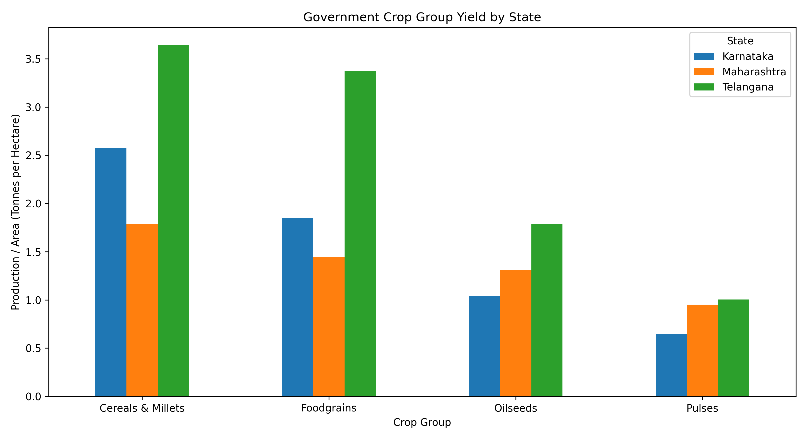
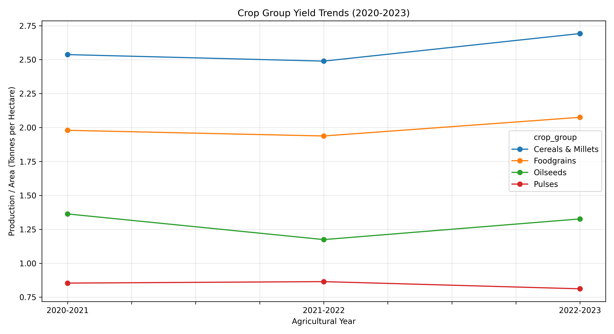
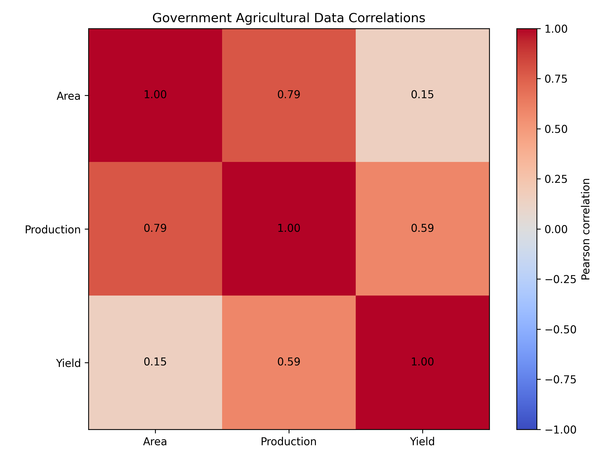

# KisanAI AgriTech

### Data Analyst Internship — Weekly Project Portfolio

## Featured Work: Week 1

### Government Agricultural Data Compilation, Cleaning & EDA

Week 1 compiles and explores government agricultural data for Karnataka,
Maharashtra and Telangana.

- **States:** Karnataka, Maharashtra and Telangana
- **Agricultural years:** 2020–2021 to 2022–2023
- **Crop groups:** Cereals & Millets, Foodgrains, Oilseeds and Pulses
- **Original records:** 1,164
- **Cleaned records:** 1,153
- **Records removed during cleaning:** 11 records with missing measurements

### Correlation Findings

- **Area vs Production:** +0.786
- **Production vs Yield:** +0.592
- **Area vs Yield:** +0.149

### Key Insights

- Cultivated area has a strong positive association with production.
- Production has a moderate positive association with yield.
- Cultivated area has a weak positive association with yield.
- Telangana has the highest pooled weighted yield across the four reported
  crop groups in the available data.

### Week 1 Visualizations

**Government crop-group yield comparison**

**Agricultural yield trends**

**Correlation heatmap**

### Week 1 Deliverables

- [Jupyter notebook](notebooks/01_data_understanding.ipynb)
- [Week 1 EDA report](reports/week1_eda_report.md)
- Cleaned government dataset: [crop-group EDA data (CSV)](data/processed/government_crop_groups_eda.csv)
- Supporting summaries: [state and crop-group summary (CSV)](data/processed/government_state_group_summary.csv) · [correlation matrix (CSV)](data/processed/government_correlation_matrix.csv)
- EDA charts: [government crop-group yield](reports/figures/government_crop_group_yield.png) · [yield trends](reports/figures/government_yield_trends.png) · [correlation heatmap](reports/figures/government_correlation_heatmap.png)

Raw source files, rainfall inputs and client-provided datasets are not included.
The notebook's saved outputs have been cleared to avoid publishing client data;
running cells that use client inputs requires separately authorized local files.

### Limitations

- Government data currently contains crop-group aggregates rather than
  individual crop yields.
- Rainfall files have not been integrated into the analysis.
- Rice rainfall–yield correlation is not yet established.
- Cotton prediction noise has not yet been verified.
- The full client checkpoint is not complete.

## Portfolio Roadmap

This repository is organized to support future weekly additions. Week 1 results
remain scoped to the government-data analysis above.

## Week 3 — Crop Yield Prediction and Model Evaluation

Week 3 trains four historical, crop-specific Random Forest models for Rice,
Soybean, Cotton and Sugarcane. District names were standardized and
previous-year yield was used as a lag feature.

- **Historical records:** 4,916 cleaned records; 4,415 have valid lag features.
- **Evaluation:** RMSE and MAPE.
- **Model comparison:** Random Forest and Gradient Boosting were compared with
  a previous-year yield baseline.
- **Cotton Random Forest:** RMSE of 1.3449 bales/ha and MAPE of 41.75%.
  Its RMSE is approximately 14.26% lower than the previous-year baseline.
- **Remaining work:** Soil-type data and combined weather-plus-lag modelling
  are still pending; the full client requirements are not yet complete.

See the [Week 3 final checkpoint report](reports/week3_final_checkpoint_report.md),
[model notebook](notebooks/02_crop_yield_models.ipynb),
[cleaned lag-feature dataset](data/processed/district_annual_yield_lags_clean.csv),
and [baseline comparison](reports/week3_baseline_comparison.csv).
